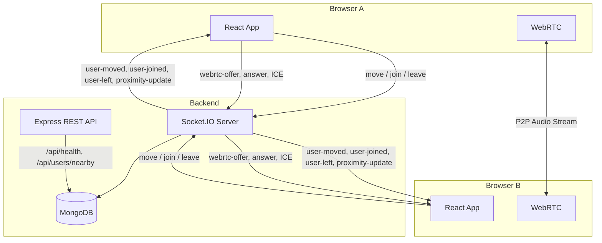

# ProxiSpeak — Geospatial Proximity Audio Ecosystem

> A real-time virtual office where users appear as avatars on a 2D map, move around freely, and communicate through proximity-based voice chat. Audio volume changes automatically based on how close users are to each other.

---

## Features

- 🚪 **Reference 1 Guest Login** — Premium royal blue welcome screen with large white rounded container; simplified guest identification requiring **only Full Name & Email Address** (no passwords, OTP, magic links, or auth codes), instant guest access, and honest live connection status
- 🏢 **Reference 2 Realistic Corporate Workplace** — Bright modern office layout with Reception area & guest terminal, 6 employee workstations with dual monitors & keyboards, glass executive conference suite with 75" display, acoustic focus booths, collaboration zone with rolling whiteboard, refreshment & espresso bar, breakout lounge with sectional sofa, and architectural walking paths with potted plants
- 🪑 **Interactive Workstations & Sitting Mode** — Avatars can sit at desks and focus booths by pressing `E` or clicking "Sit Here", displaying active workstation halo and broadcasting occupancy across peers
- 🧱 **Furniture Collision & Wall Sliding** — Full collision detection preventing avatars from passing through desks, tables, and reception counter, with smooth axis sliding along walls
- 💬 **In-Room Text Chat** — Room-scoped real-time messaging with participant badges, timestamps, and auto-scrolling; conversations remain isolated per room
- 🏢 **Multiple Office Rooms** — Public General Office, dedicated Meeting Room, and quiet Focus Room with live participant badges
- 🔒 **Private Meeting Rooms** — Collision-free `PRV-XXXX` invitation codes, host transfer tolerance, 1-click code copying, destructive leave confirmation dialog, and auto-cleanup
- 🎨 **Avatar & Profile Customization** — Custom display names (XSS-sanitized), 10-color SaaS palette, badge styles (Star ⭐, Crown 👑, Diamond 💎), and 3-Tier Availability Statuses (**Online**, **Busy**, **Away**) with `localStorage` and MongoDB synchronization
- 💎 **Premium SaaS Design** — Crisp white and soft off-white surfaces, blue & cyan accents, refined cards, restrained glassmorphism, accessible inline SVG icon library, and reduced-motion support
- 👥 **Real-Time Presence** — Live avatars powered by Socket.IO; room-scoped join/leave events and movements
- 🏃 **Avatar Movement** — WASD / arrow keys and on-screen compass direction pad; server-authoritative position clamping
- 📍 **Geospatial Proximity Engine** — MongoDB with `2dsphere` index; earshot radius filtering strictly within the same room; supports both `$geoWithin` boundary scans and `$near` distance-sorted lookups (`GET /api/users/near`)
- 🔊 **Stereo Spatial Audio & Raycast Obstacles** — Web Audio API `StereoPannerNode` for dynamic left/right ear panning (-1.0 to +1.0) and AABB raycast sound obstruction across glass walls, acoustic booths, and desks with material attenuation
- ⚡ **60 FPS Performance Engine** — Unobtrusive canvas frame-rate diagnostics probe tracking render ticks and frame latency in real time
- 🔄 **Horizontal Scaling & Redis Pub/Sub** — Multi-instance clustering support via `@socket.io/redis-adapter` and `ioredis` with automatic graceful fallback to in-memory mode
- 💾 **Persistent Office Layouts** — MongoDB `OfficeLayout` schema and REST endpoints (`GET /api/layouts`, `GET /api/layouts/:roomId`, `PUT /api/layouts/:roomId`) for room layouts, obstacle sound absorption, and workstations
- 🎤 **Microphone Controls** — Request, mute/unmute, and hardware-releasing turn-off controls with permission status
- 📱 **Responsive UI** — Accessible desktop, tablet, and mobile layouts with zero horizontal overflow

---

## Architecture



---

## Technology Stack

| Layer | Technology |
|-------|-----------|
| Frontend framework | React 19 + Vite 8 |
| Rendering | HTML5 Canvas API |
| Styling | CSS3 (vanilla — no Tailwind) |
| Real-time | Socket.IO client v4 |
| Voice | WebRTC browser API + Web Audio API |
| Backend runtime | Node.js (ESM) |
| HTTP server | Express 5 |
| WebSocket server | Socket.IO v4 |
| Database | MongoDB + Mongoose 8 |
| Language | JavaScript / JSX only |

---

## Folder Structure

```
proxispeak/
├── README.md
├── .gitignore
│
├── backend/
│   ├── server.js             # Main server entry point
│   ├── package.json
│   ├── .env.example          # Copy to .env and fill in values
│   └── src/
│       ├── config/
│       │   └── db.js         # MongoDB connection
│       ├── models/
│       │   └── Session.js    # Mongoose model + 2dsphere index
│       └── utils/
│           └── proximity.js  # Server-side distance + clamp helpers
│
└── frontend/
    ├── index.html
    ├── package.json
    ├── vite.config.js
    └── src/
        ├── main.jsx          # React entry point
        ├── App.jsx           # Main component — wires all hooks
        ├── App.css           # Full ProxiSpeak design system
        ├── index.css         # Global resets
        ├── components/
        │   ├── Icons.jsx          # Lightweight accessible inline SVG icons
        │   └── WelcomePage.jsx    # Premium two-column welcome & join portal
        ├── services/
        │   └── socket.js     # Singleton Socket.IO client
        ├── hooks/
        │   ├── useSocket.js       # Presence, room sync, profile customization
        │   ├── useOfficeCanvas.js # 2D canvas drawing loop with 3-tier statuses
        │   └── useWebRTC.js       # WebRTC mesh + spatial audio GainNodes
        └── utils/
            └── proximity.js  # Distance, nearby filter, volume curve
```

---

## Prerequisites

- **Node.js** 18 or later — https://nodejs.org
- **MongoDB** 6+ (local) **or** a free [MongoDB Atlas](https://www.mongodb.com/atlas) cluster
- A modern browser (Chrome / Edge / Firefox) with microphone support for voice chat
- Two separate browser windows or profiles to test multi-user features

---

## Setup — Windows PowerShell

### 1. Clone the repository

```powershell
git clone https://github.com/<your-org>/proxispeak.git
Set-Location proxispeak
```

### 2. Backend setup

```powershell
Set-Location backend
Copy-Item .env.example .env
# Edit .env and set MONGODB_URI if you have MongoDB Atlas
npm install
```

### 3. Frontend setup

```powershell
Set-Location ..\frontend
npm install
```

---

## MongoDB Configuration

**Option A — Local MongoDB**

Install MongoDB Community Edition: https://www.mongodb.com/try/download/community

```powershell
# Start MongoDB service (run once after install)
net start MongoDB
```

In `backend\.env`:
```
MONGODB_URI=mongodb://localhost:27017/proxispeak
```

**Option B — MongoDB Atlas (free tier)**

1. Create a free cluster at https://cloud.mongodb.com
2. Create a database user and whitelist your IP
3. Copy the connection string into `backend\.env`:

```
MONGODB_URI=mongodb+srv://<user>:<password>@<cluster>.mongodb.net/proxispeak
```

> **Note:** The server falls back to in-memory only if `MONGODB_URI` is empty or the connection fails. Core features (movement, presence) still work; geospatial persistence is unavailable.

---

## Running Locally

Open **two** PowerShell terminals.

**Terminal 1 — Backend:**
```powershell
Set-Location D:\proxispeak\backend
npm run dev
```
Expected output:
```
[...] ProxiSpeak server listening at http://localhost:5000
[...] Frontend origin: http://localhost:5173
[...] MongoDB connected: localhost
```

**Terminal 2 — Frontend:**
```powershell
Set-Location D:\proxispeak\frontend
npm run dev
```
Expected output:
```
  VITE v8.x ready in xxx ms
  ➜  Local:   http://localhost:5173/
```

Open http://localhost:5173 in your browser.

---

## Testing with Two Users (Phase 3 Multi-Room & Avatars)

1. **Start both backend and frontend:**
   ```powershell
   # Terminal 1: Backend
   cd D:\proxispeak\backend
   npm run dev

   # Terminal 2: Frontend
   cd D:\proxispeak\frontend
   npm run dev
   ```

2. **Public Room Switching & Isolation:**
   - Open **http://localhost:5173** in Browser Window 1.
   - Open **http://localhost:5173** in Browser Window 2 (incognito or second browser profile).
   - Both start in **General Office**. Avatars and participants appear in both windows.
   - In Window 2, click **Meeting Room**. Window 2 disappears from Window 1's canvas and participant list. Window 1's room badge updates to `General: 1, Meeting: 1`.
   - Move avatar in Window 2 — Window 1 receives no movement events (room-isolated).

3. **Avatar Customization & Real-Time Sync:**
   - In Window 1, click **Customize Avatar**.
   - Set name to `"Alice"`, choose purple color (`#9664d9`), select Crown style (`👑`), and set status to **Away**.
   - Click **Save Changes**.
   - In Window 2, switch to **General Office** — Alice immediately appears in purple with a crown badge and an amber away indicator.
   - Refresh Window 1 — Alice's preferences are restored from `localStorage`.

4. **Private Meeting Rooms & Invitation Codes:**
   - In Window 1, click **New Meeting**, enter title `"Design Review"`, and click **Create & Enter**.
   - Window 1 enters the private room. Notice the invitation code chip `PRV-XXXX`. Click **Copy** (`Copied!` toast).
   - In Window 2, click **Join by Code**, enter `"PRV-INVALID"`. Notice the server error: `"Invalid or expired meeting invitation code."`.
   - In Window 2, enter the actual code from Window 1 and click **Join Meeting**. Both users now see each other in the private executive suite.

5. **Room-Scoped Proximity Audio Isolation:**
   - In Window 1 and Window 2 (both in the private room), click **Enable Microphone**.
   - Move avatars close together (within 100px earshot ring). Speak — audio is audible with distance attenuation.
   - In Window 2, click **Leave Meeting** (returns to General Office). Audio terminates immediately and peer count drops.
   - Speak in Window 1 — no audio leaks to Window 2 in General Office.

6. **Automatic Private Room Cleanup:**
   - In Window 1, click **Leave Meeting**. Both users have now left the private room; the room code is automatically pruned from server memory.

---

## Testing Proximity Audio

1. Open two browser windows as above
2. In Window 1, click **Enable Microphone** and grant permission
3. In Window 2, click **Enable Microphone** and grant permission
4. Move both avatars close together in the **same room** (within the dashed earshot ring)
5. Speak into your mic — you should hear audio in the other window
6. Move avatars apart — volume decreases; past 100px → silence
7. Switch one user to another room — audio is cut off immediately via WebRTC peer teardown

> **Troubleshooting voice chat:**
> - Ensure microphone permission is granted in browser settings
> - On the same machine, use headphones to avoid feedback
> - Chrome and Edge work best; Firefox may require `about:config` adjustments
> - Corporate VPNs / restrictive firewalls may block WebRTC — a TURN server is required in that case (see production notes below)

---

## API Reference

### REST Endpoints

| Method | Path | Description |
|--------|------|-------------|
| `GET` | `/api/health` | Server status, user count, DB status |
| `GET` | `/api/ice-servers` | Dynamic ICE server configuration (STUN/TURN) |
| `GET` | `/api/users/nearby?x=400&y=250` | Users within earshot of canvas position |

### Socket.IO Events

#### Client → Server

| Event | Payload | Description |
|-------|---------|-------------|
| `move` | `{ x: number, y: number }` | Request avatar position update (room-scoped) |
| `update-mic-status` | `{ micEnabled: boolean }` | Update user microphone broadcast status |
| `join-room` | `{ room: string, code?: string, profile?: object }` | Switch to public or private meeting room |
| `create-private-room` | `{ title: string }` | Create a private meeting with random invitation code |
| `leave-private-room` | `void` | Return to General Office |
| `update-profile` | `{ name?, avatarColor?, avatarStyle?, status? }` | Update avatar appearance and status |
| `webrtc-offer` | `{ target: string, offer: RTCSessionDescription }` | Send WebRTC offer to target peer (same room verified) |
| `webrtc-answer` | `{ target: string, answer: RTCSessionDescription }` | Send WebRTC answer to offerer (same room verified) |
| `webrtc-ice-candidate` | `{ target: string, candidate: RTCIceCandidate }` | Forward ICE candidate (same room verified) |

#### Server → Client

| Event | Payload | Description |
|-------|---------|-------------|
| `initial-users` | `User[]` | All users in the joined room |
| `user-joined` | `User` | New user joined current room |
| `user-moved` | `User` | User position updated in current room |
| `user-left` | `string` (socket ID) | User left current room / disconnected |
| `user-profile-updated` | `User` | Peer customized avatar in current room |
| `user-mic-status` | `{ id: string, micEnabled: boolean }` | Peer microphone status changed |
| `proximity-update` | `string[]` (socket IDs) | IDs of users within earshot in same room |
| `room-info` | `{ room, title, isPrivate, code?, hostSocketId? }` | Active room metadata |
| `room-counts` | `{ [roomName]: number }` | Real-time participant counts per room |
| `room-error` | `{ message: string }` | Room join failure or rejection notice |
| `webrtc-offer` | `{ from: string, offer }` | Incoming WebRTC offer |
| `webrtc-answer` | `{ from: string, answer }` | Incoming WebRTC answer |
| `webrtc-ice-candidate` | `{ from: string, candidate }` | Incoming ICE candidate |

**User object:**
```json
{
  "id": "abc123",
  "name": "Alice",
  "x": 400,
  "y": 250,
  "micEnabled": true,
  "room": "general",
  "avatarColor": "#9664d9",
  "avatarStyle": "crown",
  "status": "online"
}
```

---

## Coordinate System

```
Canvas:  800 × 500 pixels (logical units)
MongoDB: GeoJSON Point — coordinates normalised to [0, 1]

  longitude = x / 800   (range 0.0 → 1.0)
  latitude  = y / 500   (range 0.0 → 1.0)

Earshot radius: 100 canvas pixels = 0.125 normalised units

Volume attenuation: gain = (1 - dist/radius)²
  dist = 0px   → gain = 1.0  (full volume)
  dist = 50px  → gain = 0.25
  dist = 100px → gain = 0.0  (silent)
```

---

## Git Workflow

```powershell
# Create a feature branch
git checkout -b feature/your-feature-name

# Stage, commit, push
git add .
git commit -m "feat: describe your change"
git push origin feature/your-feature-name

# Open a pull request on GitHub for code review
```

Branch naming convention: `feature/`, `fix/`, `docs/`, `test/`

---

## Known Limitations

| Limitation | Detail |
|-----------|--------|
| **WebRTC P2P scaling** | Full-mesh WebRTC becomes expensive above ~10 simultaneous voice users. Each user maintains N-1 peer connections. For 50+ voice users, a Selective Forwarding Unit (SFU) like mediasoup or LiveKit is recommended. |
| **TURN server** | Users behind symmetric NATs or corporate firewalls may fail WebRTC connectivity. A TURN server (e.g., Coturn) is required for production. Never hardcode TURN credentials — inject via environment variables. |
| **No authentication** | Users join as anonymous guests with customizable display names and avatars. Full enterprise authentication (OAuth/SSO) is planned for future milestones. |
| **Private room persistence** | Private meeting rooms (`PRV-XXXX`) are maintained in server memory with automatic cleanup when all members leave. They reset on server restart, while user sessions and positions are indexed in MongoDB. |
| **Load tested** | Manual testing validated to ~10 concurrent users on a local machine. 50+ users requires horizontal scaling and an SFU. |

---

## Production Deployment Notes

1. Set `NODE_ENV=production` in environment
2. Set `FRONTEND_URL` to your production domain
3. Use a process manager (`pm2`) or containerise with Docker
4. Add a TURN server and set credentials in environment variables only
5. Put Nginx or a load balancer in front of the Node.js server
6. Enable MongoDB Atlas network restrictions and IP allowlisting
7. Use HTTPS — WebRTC requires a secure context in all modern browsers

---

## Environment Variables

### Backend (`backend/.env`)

| Variable | Default | Description |
|---------|---------|-------------|
| `PORT` | `5000` | Backend listen port |
| `FRONTEND_URL` | `http://localhost:5173` | Allowed CORS origin |
| `MONGODB_URI` | *(empty)* | MongoDB connection string (falls back to in-memory) |
| `STUN_URLS` | Google STUN | Comma-separated STUN server URLs |
| `TURN_URL` | *(empty)* | Optional TURN server URL (e.g. `turn:turn.example.com:3478`) |
| `TURN_USERNAME` | *(empty)* | Optional TURN username |
| `TURN_CREDENTIAL` | *(empty)* | Optional TURN credential |
| `MOVE_RATE_LIMIT` | `20` | Max move events per second per user |
| `REDIS_URL` | *(empty)* | Optional Redis pub/sub URL for multi-instance clustering (e.g. `redis://:pwd@127.0.0.1:6379`) |
| `REDIS_HOST` | *(empty)* | Optional Redis hostname |
| `REDIS_PORT` | `6379` | Optional Redis port |
| `REDIS_PASSWORD` | *(empty)* | Optional Redis password |

### REST API Endpoints

| Method | Endpoint | Description |
|--------|----------|-------------|
| `GET` | `/api/health` | Service health, DB state, Redis adapter state, active user counts |
| `GET` | `/api/presence` | Real-time directory of all connected office participants |
| `GET` | `/api/ice-servers` | Dynamic WebRTC STUN/TURN configuration |
| `GET` | `/api/users/nearby?x=400&y=250` | `$geoWithin` spherical boundary query for nearby users |
| `GET` | `/api/users/near?x=400&y=250&maxDistance=100` | 2dsphere `$near` geospatial lookup sorted nearest-first with query latency timing |
| `GET` | `/api/layouts` | Returns all office room layouts and acoustic obstacle profiles |
| `GET` | `/api/layouts/:roomId` | Returns floor plan, obstacles, and workstations for a specific room |
| `PUT` | `/api/layouts/:roomId` | Persists customized furniture, wall boundaries, and sound absorption factors |

### Frontend (`frontend/.env`)

| Variable | Default | Description |
|---------|---------|-------------|
| `VITE_SOCKET_URL` | `http://localhost:5000` | Socket.IO server address |
| `VITE_STUN_URLS` | Google STUN | Client-side STUN URLs fallback |
| `VITE_TURN_URL` | *(empty)* | Client-side TURN server URL |
| `VITE_TURN_USERNAME` | *(empty)* | Client-side TURN username |
| `VITE_TURN_CREDENTIAL`| *(empty)* | Client-side TURN credential |

---

## Automated Verification & Testing

Run unit tests for proximity calculations, distance formulas, volume curves, and coordinate normalization:

```powershell
npm --prefix backend test
```

Build the frontend bundle:

```powershell
npm --prefix frontend run build
```

---

*ProxiSpeak — Internship Team Project · Built with ❤️ using JavaScript, React, Node.js, Socket.IO, MongoDB, and WebRTC*
