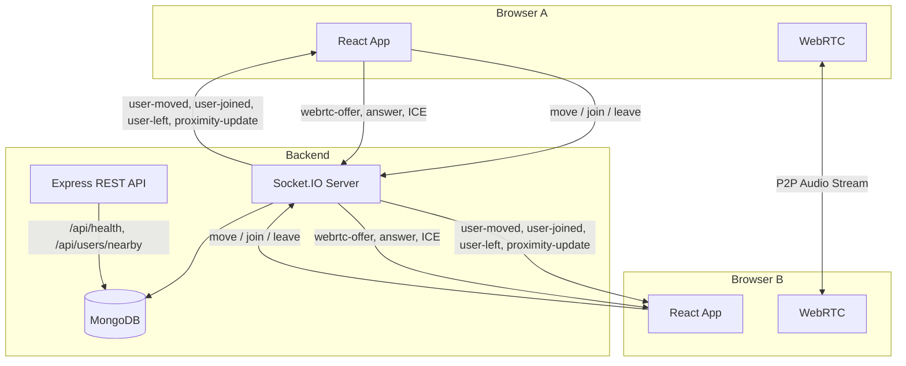

# ProxiSpeak — Geospatial Proximity Audio Ecosystem

> A real-time virtual office where users appear as avatars on a 2D map, move around freely, and communicate through proximity-based voice chat. Audio volume changes automatically based on how close users are to each other.

---

## Features

- 🗺 **2D Virtual Office** — Canvas-rendered office with Focus Zone, Collaboration, Meeting Space, and Common Area
- 👥 **Real-Time Presence** — Live avatars powered by Socket.IO; join/leave events are instant
- 🏃 **Avatar Movement** — WASD / arrow keys and on-screen buttons; server-authoritative position clamping
- 📍 **Geospatial Proximity Engine** — MongoDB with `2dsphere` index; `$geoWithin` queries detect nearby users
- 🔊 **Spatial Voice Chat** — WebRTC peer connections with Web Audio API `GainNode` for smooth distance-based volume
- 🎤 **Microphone Controls** — Request, mute, unmute; visible permission status
- 📱 **Responsive UI** — Works on desktop, tablet, and mobile

---

## Architecture



---

## Technology Stack

| Layer | Technology |
|-------|-----------|
| Frontend framework | React 19 + Vite 8 |
| Rendering | HTML5 Canvas API |
| Styling | CSS3 (vanilla — no Tailwind) |
| Real-time | Socket.IO client v4 |
| Voice | WebRTC browser API + Web Audio API |
| Backend runtime | Node.js (ESM) |
| HTTP server | Express 5 |
| WebSocket server | Socket.IO v4 |
| Database | MongoDB + Mongoose 8 |
| Language | JavaScript / JSX only |

---

## Folder Structure

```
proxispeak/
├── README.md
├── .gitignore
│
├── backend/
│   ├── server.js             # Main server entry point
│   ├── package.json
│   ├── .env.example          # Copy to .env and fill in values
│   └── src/
│       ├── config/
│       │   └── db.js         # MongoDB connection
│       ├── models/
│       │   └── Session.js    # Mongoose model + 2dsphere index
│       └── utils/
│           └── proximity.js  # Server-side distance + clamp helpers
│
└── frontend/
    ├── index.html
    ├── package.json
    ├── vite.config.js
    └── src/
        ├── main.jsx          # React entry point
        ├── App.jsx           # Main component — wires all hooks
        ├── App.css           # Full ProxiSpeak design system
        ├── index.css         # Global resets
        ├── services/
        │   └── socket.js     # Singleton Socket.IO client
        ├── hooks/
        │   ├── useSocket.js       # Presence, movement, reconnect
        │   ├── useOfficeCanvas.js # Canvas drawing loop
        │   └── useWebRTC.js       # WebRTC + spatial audio
        └── utils/
            └── proximity.js  # Distance, nearby filter, volume curve
```

---

## Prerequisites

- **Node.js** 18 or later — https://nodejs.org
- **MongoDB** 6+ (local) **or** a free [MongoDB Atlas](https://www.mongodb.com/atlas) cluster
- A modern browser (Chrome / Edge / Firefox) with microphone support for voice chat
- Two separate browser windows or profiles to test multi-user features

---

## Setup — Windows PowerShell

### 1. Clone the repository

```powershell
git clone https://github.com/<your-org>/proxispeak.git
Set-Location proxispeak
```

### 2. Backend setup

```powershell
Set-Location backend
Copy-Item .env.example .env
# Edit .env and set MONGODB_URI if you have MongoDB Atlas
npm install
```

### 3. Frontend setup

```powershell
Set-Location ..\frontend
npm install
```

---

## MongoDB Configuration

**Option A — Local MongoDB**

Install MongoDB Community Edition: https://www.mongodb.com/try/download/community

```powershell
# Start MongoDB service (run once after install)
net start MongoDB
```

In `backend\.env`:
```
MONGODB_URI=mongodb://localhost:27017/proxispeak
```

**Option B — MongoDB Atlas (free tier)**

1. Create a free cluster at https://cloud.mongodb.com
2. Create a database user and whitelist your IP
3. Copy the connection string into `backend\.env`:

```
MONGODB_URI=mongodb+srv://<user>:<password>@<cluster>.mongodb.net/proxispeak
```

> **Note:** The server falls back to in-memory only if `MONGODB_URI` is empty or the connection fails. Core features (movement, presence) still work; geospatial persistence is unavailable.

---

## Running Locally

Open **two** PowerShell terminals.

**Terminal 1 — Backend:**
```powershell
Set-Location D:\proxispeak\backend
npm run dev
```
Expected output:
```
[...] ProxiSpeak server listening at http://localhost:5000
[...] Frontend origin: http://localhost:5173
[...] MongoDB connected: localhost
```

**Terminal 2 — Frontend:**
```powershell
Set-Location D:\proxispeak\frontend
npm run dev
```
Expected output:
```
  VITE v8.x ready in xxx ms
  ➜  Local:   http://localhost:5173/
```

Open http://localhost:5173 in your browser.

---

## Testing with Two Users

1. Start both servers (see above)
2. Open **http://localhost:5173** in Browser Window 1
3. Open **http://localhost:5173** in Browser Window 2 (or a private/incognito window)
4. Both should show a green **Connected** dot
5. Move one avatar — the other window should update in real time

---

## Testing Proximity Audio

1. Open two browser windows as above
2. In Window 1, click **Enable Microphone** and grant permission
3. In Window 2, click **Enable Microphone** and grant permission
4. Move both avatars close together (within the dashed earshot ring)
5. Speak into your mic — you should hear audio in the other window
6. Move avatars apart — volume decreases; past 100px → silence

> **Troubleshooting voice chat:**
> - Ensure microphone permission is granted in browser settings
> - On the same machine, use headphones to avoid feedback
> - Chrome and Edge work best; Firefox may require `about:config` adjustments
> - Corporate VPNs / restrictive firewalls may block WebRTC — a TURN server is required in that case (see production notes below)

---

## API Reference

### REST Endpoints

| Method | Path | Description |
|--------|------|-------------|
| `GET` | `/api/health` | Server status, user count, DB status |
| `GET` | `/api/users/nearby?x=400&y=250` | Users within earshot of canvas position |

### Socket.IO Events

#### Client → Server

| Event | Payload | Description |
|-------|---------|-------------|
| `move` | `{ x: number, y: number }` | Request avatar position update |
| `webrtc-offer` | `{ target: string, offer: RTCSessionDescription }` | Send WebRTC offer to target peer |
| `webrtc-answer` | `{ target: string, answer: RTCSessionDescription }` | Send WebRTC answer to offerer |
| `webrtc-ice-candidate` | `{ target: string, candidate: RTCIceCandidate }` | Forward ICE candidate |

#### Server → Client

| Event | Payload | Description |
|-------|---------|-------------|
| `initial-users` | `User[]` | All current users on connect |
| `user-joined` | `User` | New user joined |
| `user-moved` | `User` | User position updated |
| `user-left` | `string` (socket ID) | User disconnected |
| `proximity-update` | `string[]` (socket IDs) | IDs of users within earshot |
| `webrtc-offer` | `{ from: string, offer }` | Incoming WebRTC offer |
| `webrtc-answer` | `{ from: string, answer }` | Incoming WebRTC answer |
| `webrtc-ice-candidate` | `{ from: string, candidate }` | Incoming ICE candidate |

**User object:**
```json
{ "id": "abc123", "name": "Guest-ABC1", "x": 400, "y": 250 }
```

---

## Coordinate System

```
Canvas:  800 × 500 pixels (logical units)
MongoDB: GeoJSON Point — coordinates normalised to [0, 1]

  longitude = x / 800   (range 0.0 → 1.0)
  latitude  = y / 500   (range 0.0 → 1.0)

Earshot radius: 100 canvas pixels = 0.125 normalised units

Volume attenuation: gain = (1 - dist/radius)²
  dist = 0px   → gain = 1.0  (full volume)
  dist = 50px  → gain = 0.25
  dist = 100px → gain = 0.0  (silent)
```

---

## Git Workflow

```powershell
# Create a feature branch
git checkout -b feature/your-feature-name

# Stage, commit, push
git add .
git commit -m "feat: describe your change"
git push origin feature/your-feature-name

# Open a pull request on GitHub for code review
```

Branch naming convention: `feature/`, `fix/`, `docs/`, `test/`

---

## Known Limitations

| Limitation | Detail |
|-----------|--------|
| **WebRTC P2P scaling** | Full-mesh WebRTC becomes expensive above ~10 simultaneous voice users. Each user maintains N-1 peer connections. For 50+ voice users, a Selective Forwarding Unit (SFU) like mediasoup or LiveKit is recommended. |
| **TURN server** | Users behind symmetric NATs or corporate firewalls may fail WebRTC connectivity. A TURN server (e.g., Coturn) is required for production. Never hardcode TURN credentials — inject via environment variables. |
| **No authentication** | Users join as anonymous guests. Adding authentication is out of scope for this phase. |
| **Single room** | All users share one virtual office. Multiple rooms require Socket.IO room routing. |
| **Load tested** | Manual testing to ~10 concurrent users on a local machine. 50+ users requires horizontal scaling and an SFU. |

---

## Production Deployment Notes

1. Set `NODE_ENV=production` in environment
2. Set `FRONTEND_URL` to your production domain
3. Use a process manager (`pm2`) or containerise with Docker
4. Add a TURN server and set credentials in environment variables only
5. Put Nginx or a load balancer in front of the Node.js server
6. Enable MongoDB Atlas network restrictions and IP allowlisting
7. Use HTTPS — WebRTC requires a secure context in all modern browsers

---

## Environment Variables

| Variable | Default | Description |
|---------|---------|-------------|
| `PORT` | `5000` | Backend listen port |
| `FRONTEND_URL` | `http://localhost:5173` | Allowed CORS origin |
| `MONGODB_URI` | *(empty)* | MongoDB connection string |
| `STUN_URLS` | Google STUN | Comma-separated STUN URLs |
| `MOVE_RATE_LIMIT` | `20` | Max move events per second per user |

---

*ProxiSpeak — Internship Team Project · Built with ❤️ using JavaScript, React, Node.js, Socket.IO, MongoDB, and WebRTC*
